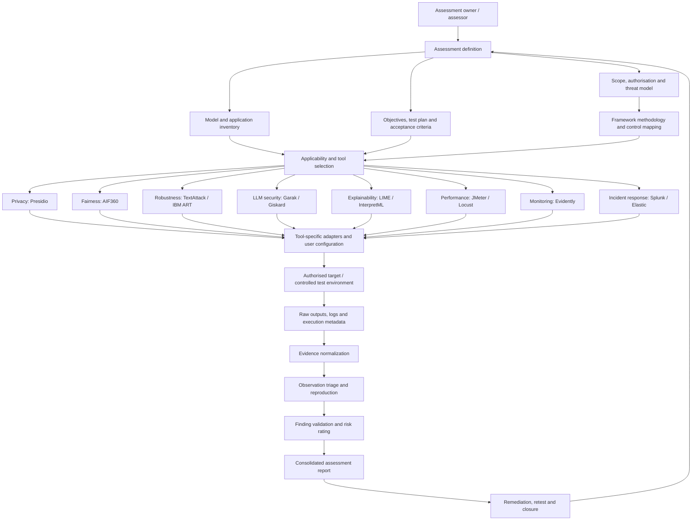
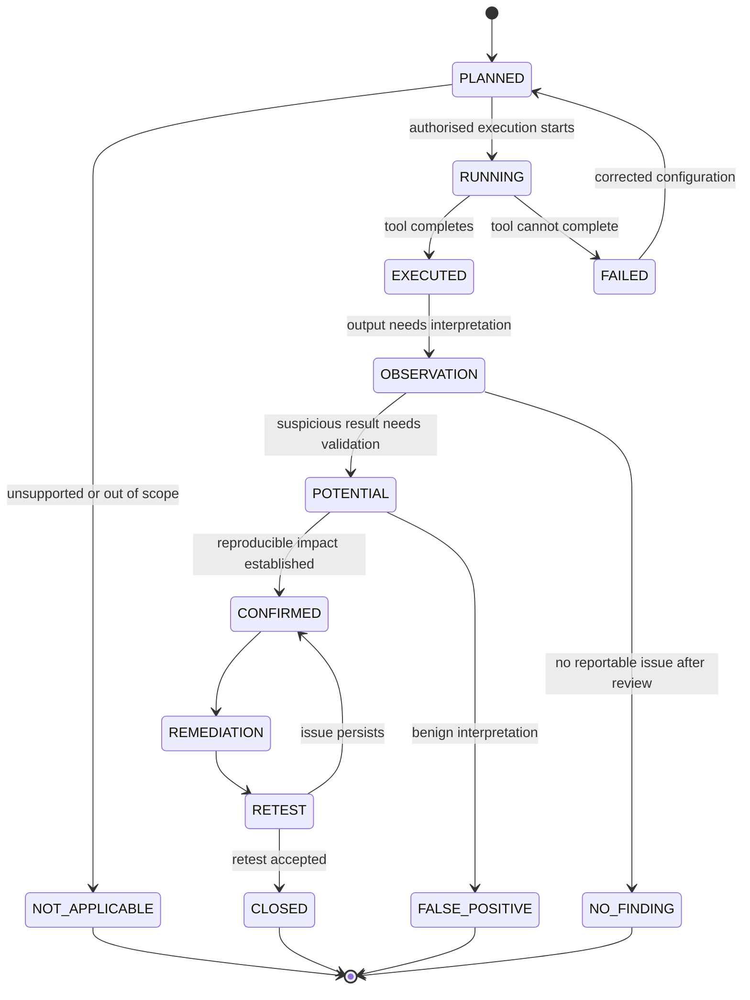

# Framework architecture and assessment flow

This is the intended logical architecture of the main framework and companion tool catalogue. It is a reference design, not a claim that a unified orchestrator or automated integrations currently exist.

## 1. Logical architecture

## 2. Architectural layers

| Layer | Responsibility | Typical artefacts |
|---|---|---|
| Assessment governance | Permission, scope, data handling, safety and threat model | Assessment plan, authorisation, exclusions, rules of engagement |
| System/model inventory | Model family, components, interfaces, data flows and deployment | Architecture notes, API contract, data-flow diagram |
| Applicability and planning | Select tools/methods that fit model, objective and interface | Applicability matrix, test cases, prerequisites, budgets |
| Tool execution | Configure and operate upstream tools in assessor environment | Tool config, versions, invocation, logs, exceptions |
| Evidence normalization | Preserve source evidence and map it to common fields | Raw outputs, normalized observations, evidence references |
| Validation and risk | Reproduce behaviour, assess impact, classify false positives and rate severity | Reproduction notes, impact analysis, finding decision |
| Reporting and remediation | Communicate results, owners, mitigations and retest | HTML/PDF report, finding register, remediation record |

## 3. Evidence flow

1. **Define scope:** authorised target, permitted window, data restrictions, rate limits and prohibited actions.
2. **Inventory the system:** model, task, interface, preprocessing/postprocessing, retrieval, tools, identity boundaries and dependencies.
3. **Select applicable methods:** use the model applicability matrix and record exclusions.
4. **Configure tools:** endpoint/model path, credentials, dataset, labels, thresholds, test selection and budgets. Keep credentials in environment variables or an approved secrets manager.
5. **Execute in a controlled environment:** retain exact version, configuration, invocation, timestamps, outputs and errors.
6. **Normalize without losing provenance:** source tool, source record, test ID, target, execution status, finding status, evidence reference and limitations.
7. **Triage and validate:** separate raw observations from security findings; reproduce and assess impact against the threat model.
8. **Report and retest:** include limitations, false positives, non-applicable tests, failures and untested areas.

## 4. Record lifecycle

This lifecycle is conceptual. Execution status and finding status are independent. An executed test may produce an observation, potential or confirmed finding, false positive, or no finding. A failed test does not imply a finding.

## 5. Current integration boundary

The repositories provide methodology, tool-specific guidance, sample cases, templates, a shared result schema and illustrative reports. They do **not** currently represent a single runtime that automatically discovers models, selects every compatible tool, executes all tests or correlates findings across platforms.

A future orchestrator could independently introduce:
- Model/system inventory and capability declarations.
- Versioned tool adapters with explicit input/output contracts.
- Configuration validation and secret-provider integration.
- Policy-based test selection and resource budgets.
- Isolated execution workers, cancellation and audit logs.
- Evidence storage with provenance and access controls.
- Normalization into the shared result schema.
- Human review gates for finding confirmation and risk acceptance.
- Report generation and remediation/retest tracking.

Preserve upstream tool semantics; never emulate or silently replace a test.

## 6. Trust and safety boundaries

- Test only systems for which explicit authorisation exists.
- Prefer synthetic data; minimise, redact and protect real personal/confidential data.
- Keep credentials out of source code, notebooks, reports and logs.
- Apply bounded concurrency, request rates, query budgets, timeouts and test windows.
- Do not run destructive, persistence, exfiltration or uncontrolled denial-of-service tests as routine assessment.
- Treat tool outputs and model-generated text as untrusted evidence.
- Require assessor review before confirming a security finding.
- Record unsupported tests and failures rather than silently substituting methods.

## 7. Repository relationship

- [AI-Testing-Framework](https://github.com/Gajanan108/AI-Testing-Framework): lifecycle, methodology, taxonomy, risk rating, control mapping, templates and IBM ART experiments.
- [AI-Testing-Tool-Samples](https://github.com/Gajanan108/AI-Testing-Tool-Samples): selected external tools, capabilities, configuration methods, sample cases and illustrative reports.

The main framework defines how an assessment is governed and reported. The companion explains which selected tools may support test activities and how users can configure them.
